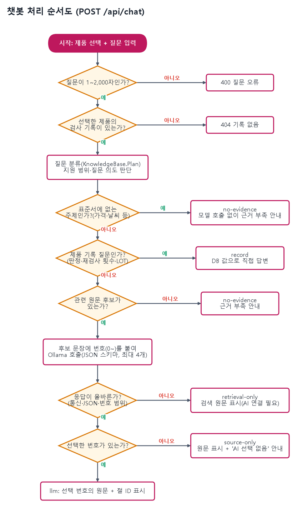
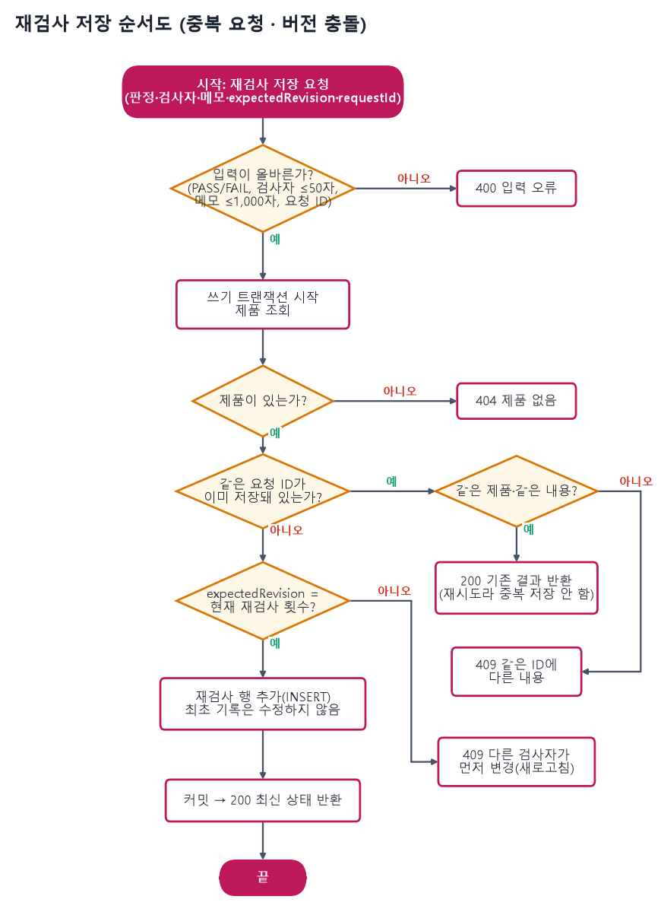
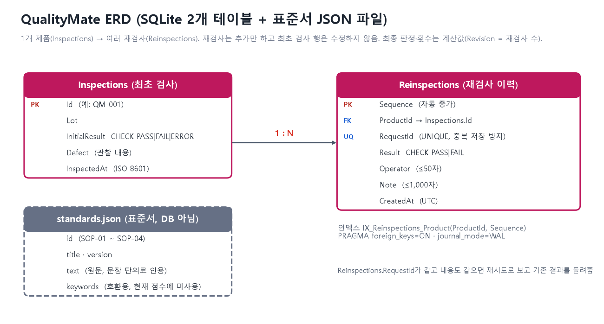
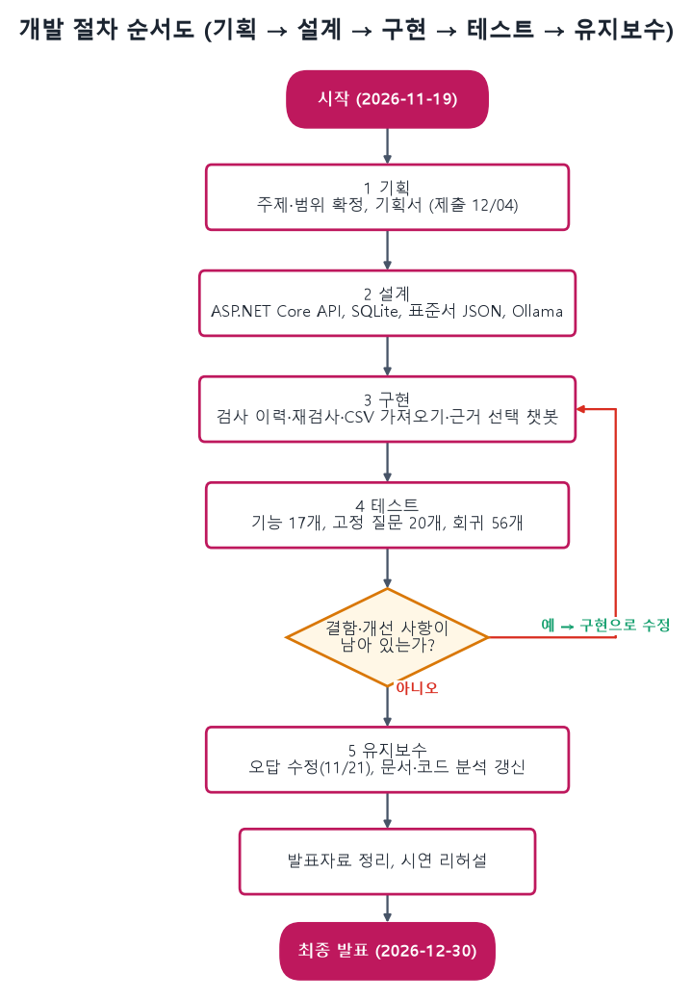

# QualityMate 프로젝트 기획서

작성일 2026-11-26 · 작성자 반재영 · 제출 2026-12-04 · 최종 발표 2026-12-30 · 과정: 인공지능 응용 시스템 개발 종합 프로젝트

## 1. 프로젝트 개요

| 항목 | 내용 |
|---|---|
| 프로젝트명 | QualityMate — 검사 이력과 작업표준서를 연계한 근거 선택형 RAG 품질관리 지원 시스템 |
| 한 줄 소개 | 제품 번호별 **실제 검사 이력**과 **작업표준서(SOP) 원문**을 한 화면에서 확인하고, 챗봇이 질문에 맞는 표준서 문장을 **골라서 원문 그대로** 보여줍니다. 모델이 문장을 새로 쓰지 않으므로 지어낼 수 없습니다. |
| 핵심 기술 | C# / .NET 10 · ASP.NET Core 최소 API · SQLite · 로컬 LLM(Ollama kanana2:3b) 근거 선택 · HTML/CSS/JavaScript |
| 개발 형태 | 개인 프로젝트(1인) |

## 2. 개발 배경과 목적

### 2.1 문제
1. **근거 찾기의 번거로움**: 검사 결과와 재검사 절차가 서로 다른 화면·문서에 있어 검사자가 관련 근거를 찾는 데 시간이 걸립니다.
2. **이력 훼손 위험**: 재검사 결과로 최초 판정을 덮어쓰면 "처음에 왜 불합격이었는지"가 사라집니다.
3. **생성형 AI의 지어내기**: 챗봇이 표준서에 없는 내용(가격, 원인 단정 등)을 그럴듯하게 만들면 품질 업무에 해가 됩니다.
4. **중복·동시 저장**: 네트워크 재시도나 두 명이 동시에 저장하면 같은 재검사가 두 번 쌓이거나 서로 덮어쓸 수 있습니다.
5. **검사 장비 결과 연동**: 머신비전 검사 프로그램(VisionQC)이 내보낸 CSV를 안전하게 가져와야 합니다.

### 2.2 목표
- 제품별 **최초 판정·현재 판정·재검사 이력**을 보존하며 조회한다(최초 기록은 절대 수정하지 않음).
- 챗봇은 **번호로 근거 문장을 선택**하게 하고, 서버가 검증한 뒤 **원문과 절 ID**만 보여 준다.
- 표준서에 없는 질문은 **모델을 호출하지 않고** 근거 부족으로 거절한다.
- 재검사 저장은 **중복 요청(요청 ID)** 과 **버전 충돌(expectedRevision)** 을 DB 트랜잭션으로 처리한다.
- VisionQC CSV를 **전체 성공 또는 전체 취소**로 가져온다.
- AI가 없어도 검색 원문으로 동작하며, 실제 AI 답변과 구분해 표시한다.
- 측정한 결과와 **한계를 있는 그대로** 문서화한다.

## 3. 사용자와 시나리오

| 사용자 | 상황 | QualityMate 사용 |
|---|---|---|
| 검사 담당자 | 불합격 제품의 재검사 절차를 확인해야 함 | 제품 선택 → 질문 → 표준서 원문과 절 ID 확인 |
| 품질 담당자 | 재검사 결과를 기록하고 이력을 추적 | 재검사 저장(판정·검사자·메모) → 최초 FAIL과 현재 PASS를 함께 확인 |
| 검사 시스템 운영자 | 머신비전 검사 결과를 가져옴 | VisionQC CSV 가져오기 → OK/NG/ERROR 반영, 같은 파일 재가져오기는 중복 제외 |

**시나리오**: QM-001(최초 FAIL, 표면 흠집 의심)을 선택한다 → "재검사에 필요한 기록은 무엇인가요?" → 서버가 SOP-03의 "재검사 판정, 검사자, 조치 및 확인 메모를 필수로 기록한다." 문장을 번호로 선택해 원문 그대로 [SOP-03]과 함께 표시 → 판정·검사자·메모를 입력해 재검사 저장 → 최초 FAIL 보존, 현재 PASS → 같은 요청을 다시 보내도 중복 저장되지 않음 → "내일 날씨는?"에는 모델 호출 없이 "근거를 찾지 못했습니다".

## 4. 주요 기능

| 구분 | 기능 | 설명 |
|---|---|---|
| 조회 | 검사 이력 | 제품별 최초·현재 판정, LOT, 관찰, 재검사 횟수와 이력 |
| 챗봇 | 근거 선택형 RAG | 후보 문장에 번호를 붙여 LLM이 JSON 스키마로 번호만 선택 → 서버가 범위·개수 검증 → 원문+절 ID 출력 |
| 챗봇 | 응답 모드 5종 | `llm`(AI 선택) · `source-only`(AI가 선택 안 함) · `retrieval-only`(AI 오류) · `no-evidence`(근거 없음) · `record`(DB 값) |
| 챗봇 | 범위 밖 거절 | 가격·날씨·주식 등 표준서에 없는 주제는 모델 호출 없이 거절 |
| 저장 | 재검사 저장 | 판정·검사자·메모 필수, 최초 기록 보존, 요청 ID 중복 방지, 버전 충돌 409 |
| 연동 | VisionQC CSV | 헤더 8개 검증, OK→PASS·NG→FAIL·ERROR 유지, 중복 제외·충돌 시 전체 롤백 |
| 운영 | 환경 진단 | `QualityMate.exe --diagnose`로 필수 파일·권한·설정·AI 모델·포트 점검(종료 코드 0/1/2) |

## 5. 시스템 설계 개요

### 5.1 아키텍처

```
브라우저(wwwroot/)  ──HTTP──▶  Program.cs (최소 API)
  제품·질문·근거·재검사·CSV        │
                                  ├─ InspectionStore.cs   SQLite: 검사·재검사, 트랜잭션, CSV 가져오기
                                  ├─ KnowledgeBase.cs     질문 분류 + 표준서 원문 문장 후보 선택
                                  ├─ VisionCsv.cs         VisionQC CSV 파싱·검증
                                  ├─ RuntimeDiagnostics.cs 환경 진단(--diagnose)
                                  └─ Ollama(kanana2:3b)   근거 번호 선택(JSON 스키마)
```

### 5.2 챗봇 처리 — 근거 선택형 RAG
1. 질문 길이(1~2,000자)와 제품 존재를 검증한다.
2. `KnowledgeBase.Plan`이 질문 의도를 분류한다. 표준서에 없는 주제는 거절하고, 판정·재검사 횟수·LOT 질문은 DB에서 직접 답한다.
3. 지원하는 절차 질문이면 관련 **원문 문장 후보**를 만든다.
4. 후보에 0부터 번호를 붙여 LLM에 보내고, **JSON 스키마**(`evidenceIds` 정수 배열, 최대 4개)로 번호만 답하게 한다(temperature 0).
5. 서버가 응답을 검증한다: 원시 배열 길이 ≤ 4(중복 제거 **전** 길이로 검사), 정수, 후보 범위 안. 통과하면 해당 번호의 **원문과 절 ID**만 출력한다. 모델의 자유 문장은 사용자에게 보여 주지 않는다.
6. 통신·JSON·번호 오류는 `retrieval-only`, 선택이 비면 `source-only`로 표시해 **실제 AI 답변과 구분**한다.



### 5.3 재검사 저장 — 정합성
요청은 하나의 쓰기 트랜잭션에서 처리한다. 같은 요청 ID에 같은 내용이면 이전 성공 결과를 돌려주고(재시도 안전), 다른 내용이면 409. 새 요청은 `expectedRevision`이 현재 재검사 횟수와 같을 때만 저장한다. 최초 검사 행은 수정하지 않는다.



### 5.4 데이터 설계
SQLite 2개 테이블(Inspections, Reinspections)과 표준서 JSON 파일. `RequestId` UNIQUE, 판정 CHECK, 외래 키, WAL 모드. 상세는 데이터정의서.



### 5.5 개발 절차 순서도



## 6. 활용 기술과 선택 이유

| 기술 | 선택 이유 |
|---|---|
| C# / ASP.NET Core 최소 API | 단일 실행 파일로 배포, 타입 안전, 직무(.NET) 역량 연계 |
| SQLite (초기 계획 SQL Server에서 변경) | 설치 없이 제출·시연이 재현되도록. 트랜잭션·UNIQUE·FK·CHECK로 정합성 확보 |
| 근거 **선택**형 LLM 사용 | 자유 생성은 원문 반복·인용 누락·지어내기가 나타나 번호 선택으로 제한. 결과는 원문 그대로 |
| 로컬 LLM(Ollama kanana2:3b) | 검사 데이터가 외부로 나가지 않음, 비용 없음 |
| 규칙 기반 질문 분류 | 4개 시연 SOP에 맞춘 설명 가능한 분류. BM25·임베딩 검색이 아님을 명시 |

## 7. 평가 계획과 현재 결과

| 층 | 방법 | 결과 |
|---|---|---|
| 기능 검사 | `tools/check.ps1` 17개(조회·재검사·중복·충돌·입력·CSV·재시작 보존) | 17/17 통과(2026-11-20) |
| 고정 질문 | 도메인 16개 + 범위 밖 4개, 관련 절·인용·원문 일치·필수 구절 | 20/20 통과, LLM 호출 16개 중앙값 2.98초(2026-11-19 버전) |
| 오답 수정 후 회귀 | 실제 모델 56개, 모의 모델 계약 11개 | 56/56, 11/11 통과(2026-11-21). 실제 모델 20문항 반복: `llm` 12 · `source-only` 8 |
| 환경 진단 | 정상·모델 없음·잘못된 설정 | 종료 코드 0·2·1 확인 |

**측정에서 발견한 것(설계에 반영)**
1. 자유 생성은 원문 반복·인용 누락 → JSON 스키마 번호 선택으로 변경.
2. 단어 한 개만 겹쳐도 검색에 채택해 "제품 가격은 얼마인가요?"에 출하 보류 문장이 답으로 나옴(11/21) → 지원 범위 밖 질문을 **모델 호출 전에** 거절하고 의도에 맞는 문장만 후보로 삼도록 수정.
3. `source-only`(AI가 선택 안 함)를 AI 성공으로 세면 정확도를 과장 → 별도 모드로 구분해 표시, 통계에서 제외.

**한계**: 가상 검사 데이터 3건과 직접 작성한 가상 표준서 4개 절로 검증했습니다. 고정 질문 통과는 검색·인용·원문 일치를 본 것이며 실제 현장 정확도가 아닙니다. 규칙 기반 분류라 새 표현·복합 질문·문서 확장에는 추가 평가가 필요합니다. 실제 카메라 추론과 다른 PC 실행은 검증하지 않았습니다.

## 8. 개발 단계와 일정

| 단계 | 기간 | 산출물 | 상태(2026-11-26) |
|---|---|---|---|
| 1 기획 | 11/19~12/04 | 기획서(본 문서) | 작성 완료, 제출 12/04 |
| 2 설계 | 11/19~11/20 | 요구사항 분석서·명세서, ERD, 순서도 | 완료 |
| 3 구현 | 11/19~11/21 | 이력·재검사·CSV·챗봇·화면·진단 | 완료 |
| 4 테스트 | 11/19~12/16 | 기능 17·질문 20·회귀 56, 발표 환경 점검 | 1차 완료, 발표 환경 점검 예정 |
| 5 유지보수 | 12/05~12/23 | 현장 용어 검토, 오류 보완 | 예정 |
| 마무리 | 12/24~12/30 | 최종 제출·리허설·발표 | 발표 12/30 |

## 9. 위험과 대응

| 위험 | 대응 |
|---|---|
| 표준서가 가상이라 실제 업무와 다름 | 한계로 명시, 실제 문서는 현장 담당자 검토 후 교체(평가 재실시) |
| 규칙 분류가 새 질문 표현을 놓침 | 지원 범위 밖은 안전하게 거절, 질문 회귀 세트로 개정 시 재검증 |
| 3B 모델이 근거를 선택하지 않음(실측 20문항 중 8) | `source-only`로 원문을 보여 주고 AI 성공과 구분 |
| 발표 PC에 Ollama·모델 미설치 | 환경 진단(`--diagnose`)과 `AI-setup.cmd`, 모델은 자동 설치하지 않음 |
| 로그인·권한 없음 | 127.0.0.1 전용으로 실행, 다수 사용자 공개 시 인증·권한 추가 필요 |

## 10. 기대 효과와 확장

- **효과**: 근거를 찾는 시간 절감, 최초 판정 보존으로 추적성 확보, 지어내지 않는 AI 활용.
- **확장**: 실제 SOP 문서 업로드, 임베딩 검색·재순위화 비교, 문서 수 증가 시 제품별 조회·페이지네이션, 사용자 권한, VisionQC 결과 자동 수신.
