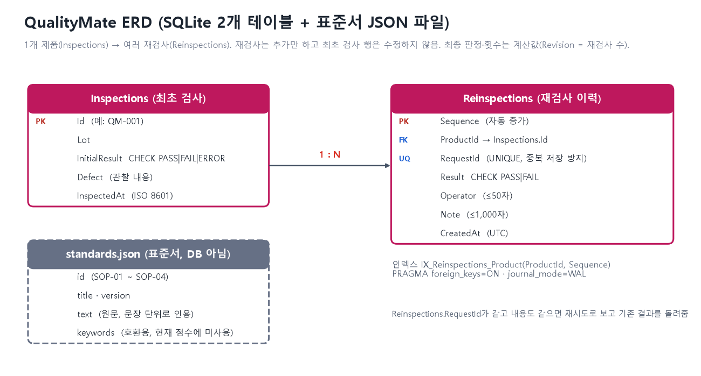

# QualityMate 데이터정의서

작성일 2026-11-26 · 작성자 반재영 · 버전 1.0 · DBMS: SQLite(Microsoft.Data.Sqlite) · 구현: `InspectionStore.cs`, `knowledge/standards.json`

## 1. ERD

- 1개 제품(`Inspections`)에 여러 재검사(`Reinspections`)가 연결됩니다(1:N).
- **최초 검사 행은 수정하지 않습니다.** 재검사는 행을 추가만 합니다. "현재 판정"과 "재검사 횟수(Revision)"는 저장하지 않고 재검사 목록에서 **계산**하므로 서로 어긋날 수 없습니다.
- 표준서는 DB가 아니라 JSON 파일입니다(문서가 4개 절뿐이라 DB를 쓰지 않음).

## 2. 저장소 개요

| 항목 | 내용 |
|---|---|
| DBMS | SQLite. `PRAGMA journal_mode=WAL`, 연결 문자열에 `ForeignKeys=True`, `DefaultTimeout=10`초 |
| 파일 | `data/qualitymate.db` (설정 `DataDirectory`로 변경 가능). 서버 종료 후 data 폴더를 백업 |
| 시각 | ISO 8601 문자열(`DateTimeOffset.ToString("O")`) |
| 스키마 생성 | 시작 시 `CREATE TABLE IF NOT EXISTS`(버전별 마이그레이션 체계는 없음) |
| 초기 데이터 | DB가 비어 있으면 `data/inspections.json`을 이관(원본 보존), 없으면 시연 제품 3개(QM-001~003) |

## 3. 테이블 정의

### 3.1 Inspections — 최초 검사
| 컬럼 | 타입 | 키 | NULL | 설명 |
|---|---|---|---|---|
| Id | TEXT | PK | N | 제품 번호. 시연 데이터는 `QM-001`, VisionQC에서 가져온 것은 `VQC-{JobId}-{검사Id}` |
| Lot | TEXT | | N | LOT. 가져온 데이터는 `VQC-JOB-{JobId}` |
| InitialResult | TEXT | CHECK | N | 최초 판정 `PASS` · `FAIL` · `ERROR`(검사 오류는 불량이 아니므로 별도 값) |
| Defect | TEXT | | N | 검사 관찰 내용(예: "표면 흠집 의심"). VisionQC의 NG는 "구체 불량 유형 미확인 · 점수 …"로 저장해 유형을 임의로 추정하지 않음 |
| InspectedAt | TEXT | | N | 검사 시각(ISO 8601, 오프셋 포함) |

### 3.2 Reinspections — 재검사 이력
| 컬럼 | 타입 | 키 | NULL | 설명 |
|---|---|---|---|---|
| Sequence | INTEGER | PK(자동증가) | N | 저장 순서. 가장 큰 값이 최신 재검사 |
| ProductId | TEXT | FK→Inspections.Id | N | 대상 제품. 없는 제품은 외래 키로 거부 |
| RequestId | TEXT | **UNIQUE** | N | 저장 요청 한 건의 GUID. 같은 요청이 두 번 들어와도 한 번만 저장 |
| Result | TEXT | CHECK | N | 재검사 판정 `PASS` 또는 `FAIL` |
| Operator | TEXT | | N | 검사자(필수, 앞뒤 공백 제거, 최대 50자) |
| Note | TEXT | | N | 조치·확인 메모(필수, 앞뒤 공백 제거, 최대 1,000자) |
| CreatedAt | TEXT | | N | 저장 시각(UTC, ISO 8601) |

인덱스: `IX_Reinspections_Product(ProductId, Sequence)` — 제품별 재검사를 순서대로 읽기 위함.

### 3.3 계산 값(저장하지 않음)
| 이름 | 계산 |
|---|---|
| Revision | 해당 제품의 재검사 행 수 |
| CurrentResult | 마지막(Sequence 최대) 재검사의 Result, 재검사가 없으면 InitialResult |

`expectedRevision`(클라이언트가 본 재검사 수)과 Revision을 비교해 동시 변경을 감지합니다.

### 3.4 standards.json — 표준서(DB 아님)
| 필드 | 설명 |
|---|---|
| id | 절 번호(`SOP-01` ~ `SOP-04`) |
| title | 절 제목(표면 흠집 의심 제품 확인, 이물 의심 제품 확인, 재검사와 이력 보존, 정상 제품 보관 등) |
| version | 문서 버전(시연용 v1.0) |
| text | 원문(문장 단위로 인용). 직접 작성한 **가상** 표준서 |
| keywords | 이전 자료와의 호환용. 현재 질문 분류에는 점수로 쓰지 않음 |

## 4. 가져오기 파일 형식 — VisionQC CSV
| 열 | 형식·검증 | 변환 |
|---|---|---|
| Id | 1 이상의 정수 | 제품 키 `VQC-{JobId}-{Id}`의 일부 |
| JobId | 1 이상의 정수 | LOT `VQC-JOB-{JobId}` |
| InspectedAtUtc | ISO 8601 UTC·오프셋 형식 | InspectedAt |
| OriginalVerdict | `OK` · `NG` · `ERROR` | PASS · FAIL · ERROR |
| DefectScore | 유한한 숫자(ERROR는 생략 가능) | Defect 문구에 점수 보존 |
| ElapsedMs | 0 이상의 유한한 숫자 | 형식 검증만 |
| ImagePath | 문자열 | 저장하지 않음 |
| ErrorMessage | 문자열 | ERROR의 Defect 문구에 포함 |

헤더 8개가 정확히 일치해야 하며, 파일 안 중복 키·1MB 초과·1,000행 초과는 거부합니다. 기존 제품과 ID가 같고 내용이 같으면 건너뛰고, 내용이 다르면 **전체를 취소**합니다.

## 5. 데이터 관리 정책

| 항목 | 정책 |
|---|---|
| 최초 기록 | 수정·삭제 기능 없음(추가 전용 이력) |
| 정합성 | 재검사·CSV는 하나의 트랜잭션. 재검사는 비교(요청 ID·expectedRevision)와 삽입이 같은 쓰기 트랜잭션 |
| SQL | 모든 값은 매개변수 바인딩(문자열 이어 붙이기 없음) |
| 백업 | 서버 실행 중 DB 파일을 복사하지 말고 종료 후 data 폴더를 백업 |
| 규모 | 전체 제품·재검사를 메모리로 읽는 소규모 시연용. 운영 규모에는 제품별 조회·페이지네이션 필요 |
| 개인정보 | 사람 이름은 검사자 칸(Operator)에만 저장. 질문 내용은 저장하지 않음 |
