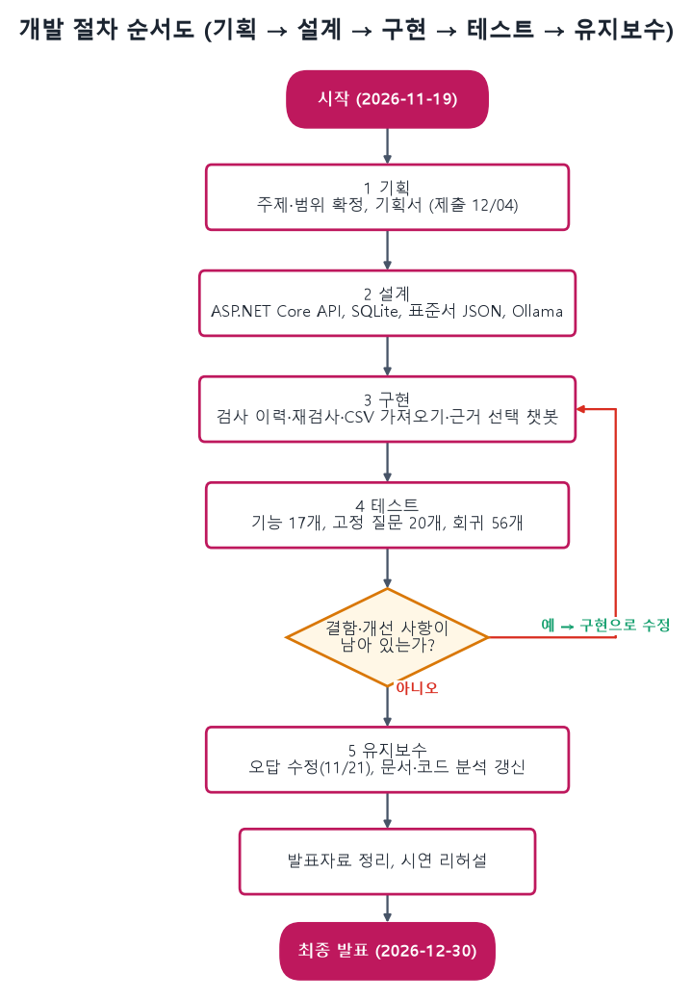
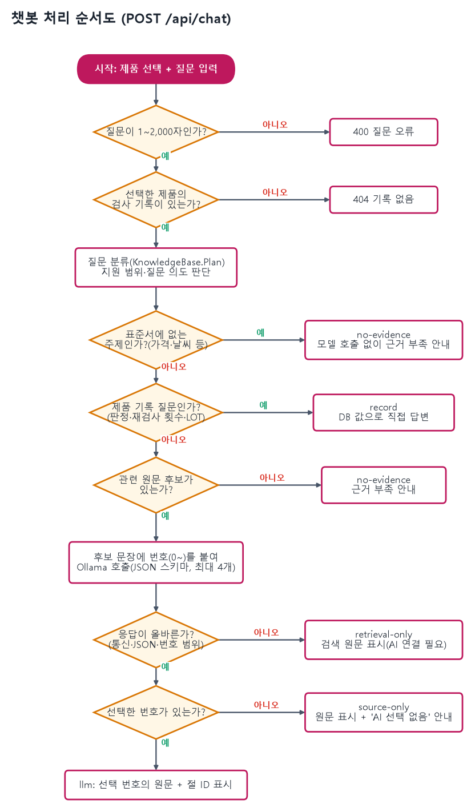
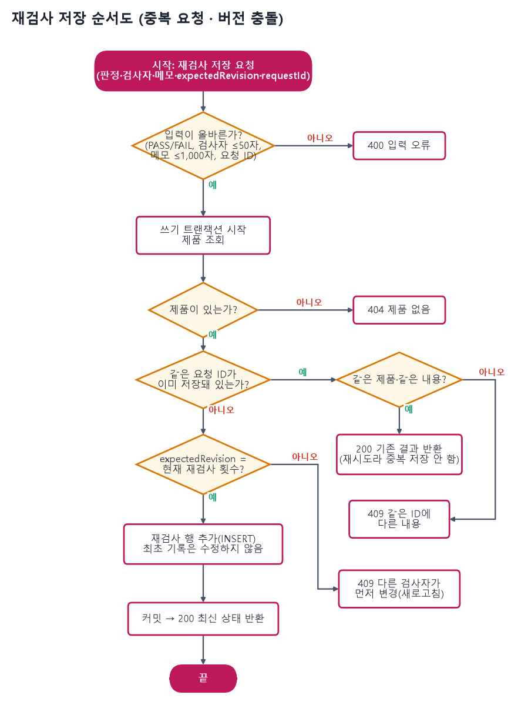
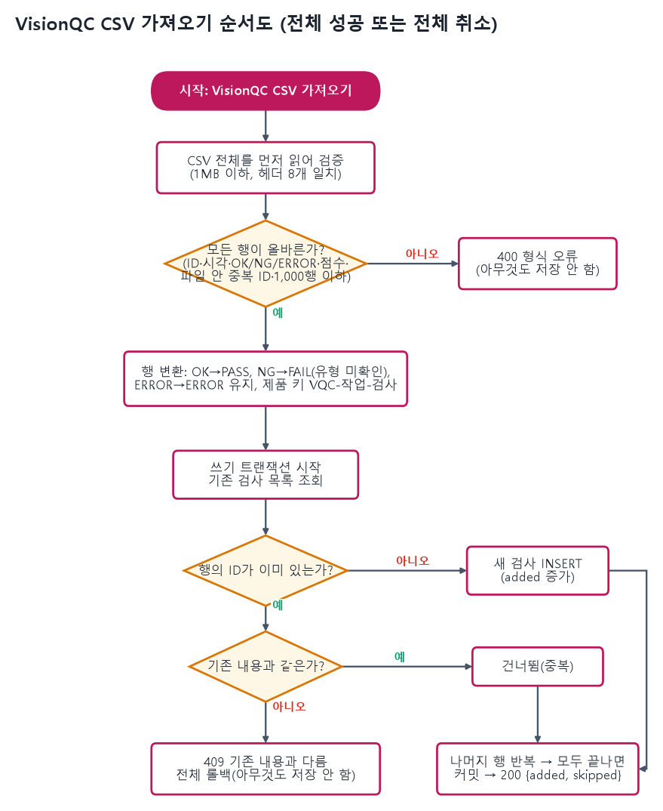

# QualityMate 순서도

작성 2026-11-26 · 작성자 반재영 · 표준 순서도 기호(둥근 사각형=시작·끝, 사각형=처리, 마름모=판단, 평행사변형=입출력)

## 1. 개발 절차 순서도

기획 → 설계 → 구현 → 테스트 → 유지보수 순으로 진행하며, 테스트에서 결함이나 개선 사항이 나오면 구현 단계로 돌아갑니다(예: 11/21 범위 밖 질문 오답 수정).

## 2. 챗봇 처리 순서도 (POST /api/chat)

| 단계 | 설명 |
|---|---|
| 입력 검증 | 질문이 1~2,000자인지, 선택한 제품의 검사 기록이 있는지(400·404). 없는 제품에 대한 사실을 지어내지 않습니다. |
| 질문 분류 | 표준서에 없는 주제(가격·날씨 등)는 **모델을 호출하지 않고** no-evidence. 판정·재검사 횟수·LOT 질문은 DB 값으로 직접 답(record). |
| 후보 선택 | 질문 의도에 맞는 표준서 원문 문장 후보를 만들고, 후보가 없으면 no-evidence. |
| LLM 호출 | 후보에 번호를 붙여 보내고 JSON 스키마로 **번호만** 답하게 합니다(최대 4개). |
| 검증 | 응답이 올바른지(통신·JSON·번호 범위·개수) 확인. 틀리면 retrieval-only. |
| 표시 | 선택이 비면 source-only(AI 선택 없음 안내), 있으면 llm — 선택한 번호의 **원문과 절 ID**만 표시합니다. |

## 3. 재검사 저장 순서도

재검사는 하나의 쓰기 트랜잭션에서 처리합니다. 같은 요청 ID·같은 내용은 **재시도**로 보고 기존 결과를 돌려주고(중복 저장 없음), 같은 요청 ID에 다른 내용이면 409입니다. 새 요청은 화면에서 본 재검사 횟수(expectedRevision)가 서버 값과 같을 때만 저장하며, 다르면 다른 검사자가 먼저 변경한 것이므로 409로 새로고침을 안내합니다. 최초 검사 행은 수정하지 않습니다.

## 4. VisionQC CSV 가져오기 순서도

파일 전체를 먼저 검증해 하나라도 잘못이면 아무것도 저장하지 않습니다(400). 검증을 통과하면 하나의 트랜잭션에서 행마다 비교합니다: 새 ID는 추가, 기존과 같은 내용은 건너뜀(중복), 기존과 내용이 다르면 **전체를 롤백**(409)합니다. 같은 파일을 다시 가져와도 결과가 달라지지 않습니다(added 0, skipped 전부).
