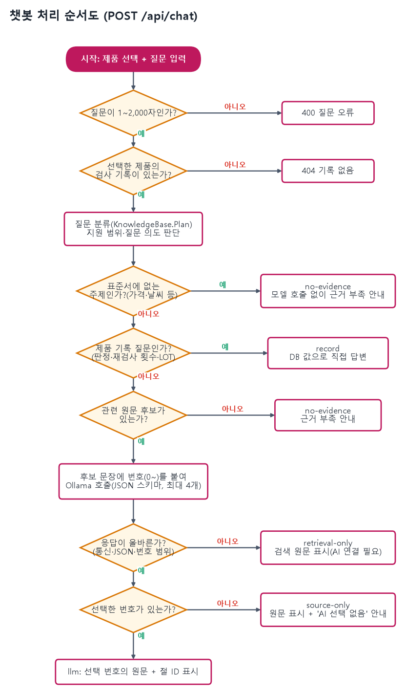

# QualityMate 요구사항 분석서

작성일 2026-11-26 · 작성자 반재영 · 버전 1.0

## 목차
1. 개요 · 2. 시스템 범위와 이해관계자 · 3. 현황 분석과 문제 정의 · 4. 사용자 요구 분석 · 5. 기능 요구사항 분석 · 6. 비기능 요구사항 분석 · 7. 제약 사항과 가정 · 8. 유스케이스 · 9. 우선순위 · 10. 추적성 · 11. 위험 분석

## 1. 개요

### 1.1 목적
검사 이력과 작업표준서를 연계해 검사 담당자가 근거를 빠르게 확인하게 하는 QualityMate의 요구사항을 분석하고, 구현·시험의 기준으로 삼는다.

### 1.2 시스템 개요
브라우저에서 제품을 선택해 검사 이력을 조회하고, 질문하면 서버가 표준서의 **원문 문장**을 근거로 골라 보여 준다. 재검사 결과는 최초 기록을 보존한 채 추가 저장하며, 머신비전 검사 프로그램(VisionQC)의 CSV를 가져올 수 있다. 모든 처리는 로컬 PC(127.0.0.1:5187)에서 이루어진다.

### 1.3 용어
| 용어 | 뜻 |
|---|---|
| SOP(작업표준서) | 작업 절차를 정한 문서. 이 프로젝트는 직접 작성한 가상 4개 절(SOP-01~04)을 사용 |
| 근거 선택형 RAG | 검색해 온 문장 후보에 번호를 붙이고 LLM이 **번호만** 고르게 하여, 서버가 원문을 그대로 출력하는 방식 |
| 재검사(Reinspection) | 최초 검사 이후 추가한 판정 기록. 최초 검사는 수정하지 않음 |
| Revision | 재검사 횟수. 현재 판정 = 마지막 재검사 결과(없으면 최초 판정) |
| 요청 ID(RequestId) | 재검사 저장 요청 한 건을 식별하는 GUID. 재시도 중복 방지에 사용 |
| ExpectedRevision | 클라이언트가 화면에서 본 재검사 횟수. 서버 값과 다르면 다른 사람이 먼저 바꾼 것(409) |
| 응답 모드 | llm · source-only · retrieval-only · no-evidence · record |

## 2. 시스템 범위와 이해관계자

| 구분 | 내용 |
|---|---|
| 범위 안 | 검사 이력 조회, 표준서 조회, 근거 선택형 챗봇, 재검사 저장, 중복·충돌 처리, VisionQC CSV 가져오기, 환경 진단 |
| 범위 밖 | 실제 카메라 연결·추론, 사용자 인증·권한, 표준서 문서 업로드, 대규모 검색, 외부 공개 배포 |

| 이해관계자 | 관심사 |
|---|---|
| 검사 담당자 | 재검사 절차의 정확한 근거, 쉬운 조회 |
| 품질 담당자 | 최초 판정 보존, 이력 추적, 재검사 기록 |
| 개발자(본인) | 지어내지 않는 AI, 정합성, 재현 가능한 배포 |
| 평가자(강사) | 요구사항–설계–시험의 일관성, 정직한 한계 표기 |

## 3. 현황 분석과 문제 정의

| 현황 | 문제 | QualityMate의 대응 |
|---|---|---|
| 검사 결과와 절차 문서가 따로 있음 | 근거를 찾는 데 시간이 걸림 | 제품 이력과 표준서를 한 화면에서 연결 |
| 재검사로 판정을 덮어쓰기 쉬움 | 최초 불합격 사유가 사라짐 | 재검사를 별도 행으로 추가, 최초 보존 |
| 챗봇이 그럴듯하게 지어냄 | 표준서에 없는 내용이 답으로 나옴 | 번호 선택 + 서버 검증 + 범위 밖 거절 |
| 재시도·동시 저장 | 중복 기록, 서로 덮어쓰기 | 요청 ID UNIQUE + ExpectedRevision + 트랜잭션 |
| 검사 장비 CSV | 일부만 저장되는 불완전 가져오기 | 전체 성공 또는 전체 취소 |

## 4. 사용자 요구 분석

| ID | 사용자 요구 |
|---|---|
| UN-01 | 제품 번호로 최초·현재 판정과 재검사 이력을 보고 싶다 |
| UN-02 | 질문하면 관련 표준서 문장과 어느 절인지 바로 알고 싶다 |
| UN-03 | 표준서에 없는 질문에 그럴듯한 거짓 답을 받고 싶지 않다 |
| UN-04 | 재검사 결과를 기록해도 최초 판정은 남아 있기를 원한다 |
| UN-05 | 저장 버튼을 두 번 눌러도, 두 사람이 동시에 저장해도 기록이 꼬이지 않기를 원한다 |
| UN-06 | 머신비전 검사 CSV를 가져오되 오류가 있으면 아무것도 저장되지 않기를 원한다 |
| UN-07 | AI가 답했는지, 원문만 보여 준 것인지 구분하고 싶다 |
| UN-08 | 발표 PC에서 실행 전에 환경 문제를 미리 알고 싶다 |

## 5. 기능 요구사항 분석

| 영역 | 요구 | 핵심 판단 |
|---|---|---|
| 조회 | 최초·현재 판정, 횟수 | 현재 판정은 저장하지 않고 "마지막 재검사 또는 최초"로 계산(불일치 방지) |
| 챗봇 | 근거 선택형 | 모델 출력은 **번호**만 허용. 원시 배열 길이를 중복 제거 전에 검사해 `[0,0,0,0,0]` 같은 위반 출력도 거부 |
| 챗봇 | 범위 밖 질문 | 단어 하나 겹침으로 검색에 채택하면 "가격" 질문에 출하 보류가 답으로 나옴 → 의도 분류 후 후보 생성 |
| 챗봇 | 기록 질문 | 판정·횟수·LOT는 DB 값이 정답이므로 모델이 만들지 않음 |
| 저장 | 중복 요청 | 같은 요청 ID·같은 내용 = 재시도(성공 반환), 같은 ID·다른 내용 = 409 |
| 저장 | 동시 변경 | 비교와 삽입이 같은 쓰기 트랜잭션 안에 있어 하나만 성공 |
| CSV | 원자성 | 먼저 전부 검증, 하나라도 기존과 충돌하면 전체 롤백 |
| 오류 | 구분 표시 | 선택이 비면 source-only, AI 오류면 retrieval-only — AI 성공으로 세지 않음 |

## 6. 비기능 요구사항 분석

| 분류 | 요구 |
|---|---|
| 정확성 | 사용자에게 보이는 답은 표준서 원문 또는 DB 값만(모델 자유 문장 금지) |
| 신뢰성 | 저장은 트랜잭션, 재시작 후에도 이력 보존, AI 연결 실패 시에도 서비스 지속 |
| 보안 | 매개변수 바인딩(SQL 주입 방지), 입력 길이 제한, 외부 공개 금지(로컬 바인딩), 오류에 내부 정보 미노출 |
| 개인정보 | 검사 데이터와 질문은 로컬에서만 처리(로컬 LLM) |
| 성능 | LLM 호출 질문 중앙값 약 3초(로컬 CPU/GPU 상황에 따라 변동) |
| 이식성 | Windows x64 자체 포함 실행 파일 제공(.NET SDK 불필요), 모델은 별도 준비 |
| 유지보수 | 모든 소스에 "무엇을·왜" 주석, 기능·질문·회귀 시험 도구 |

## 7. 제약 사항과 가정

- 개인 프로젝트(1인), 기획서 12/04·발표 12/30.
- 표준서·검사 데이터는 **직접 만든 가상 데이터**다. 실제 공장 데이터나 공인 품질 기준을 사용하지 않는다.
- 분류는 4개 시연 SOP에 맞춘 규칙 기반이다. 문서가 늘거나 바뀌면 규칙과 질문 회귀 세트를 함께 검토해야 한다.
- LLM은 3B급(kanana2:3b)이라 근거를 선택하지 않는 경우가 있다(실측 20문항 중 8).
- 모델 가중치와 Ollama는 포함하지 않는다(별도 설치·라이선스 확인).

## 8. 유스케이스

| ID | 유스케이스 | 주 흐름 | 예외 |
|---|---|---|---|
| UC-01 | 검사 이력 조회 | 제품 선택 → 최초·현재 판정·재검사 목록 | – |
| UC-02 | 표준서 질문 | 질문 입력 → 근거 문장·절 ID 표시 | 400 빈/2,000자 초과, 404 제품 없음, 범위 밖은 no-evidence |
| UC-03 | 재검사 저장 | 판정·검사자·메모 입력 → 저장 → 최초 FAIL·현재 PASS 확인 | 400 입력 오류, 404, 409 같은 ID 다른 내용, 409 버전 충돌 |
| UC-04 | CSV 가져오기 | CSV 선택 → 가져오기 → added/skipped | 400 형식 오류, 409 기존과 내용 충돌(전체 취소) |
| UC-05 | 환경 진단 | `--diagnose` 실행 → 항목별 pass/warn/fail → 종료 코드 | AI 모델 없음(코드 2), 설정 오류(코드 1) |

### 8.1 처리 순서도

## 9. 요구사항 우선순위 (MoSCoW)

| 구분 | 요구사항 |
|---|---|
| Must | FR-01·03·04·05·06·07·08·09·10·11·14, NFR-01·02·03·04 |
| Should | FR-02·12·13·15, NFR-05·06 |
| Could | 화면 테마(핑크 코드 배경) 등 표현 요소 |
| Won't | 카메라 직접 연결, 인증·권한, 문서 업로드, 외부 공개 |

## 10. 추적성

| 사용자 요구 | 기능 요구 | 설계 요소 | 시험 |
|---|---|---|---|
| UN-01 | FR-01·02 | InspectionStore.All/Read | 기능 검사 seed·재시작 보존 |
| UN-02 | FR-03·06 | KnowledgeBase, /api/chat | 고정 질문 20개 |
| UN-03 | FR-05·07 | 범위 밖 거절, 번호 검증 | 가격·날씨 질문, 모의 모델 계약 11개 |
| UN-04 | FR-08 | 별도 Reinspections 표 | preserve original and append |
| UN-05 | FR-09·10 | RequestId UNIQUE, ExpectedRevision | idempotent retry, stale revision rejected |
| UN-06 | FR-11 | VisionCsv, 트랜잭션 | 중복 CSV·충돌·오류 CSV 시험 |
| UN-07 | FR-07 | mode 필드, notice | source-only/retrieval-only 시험 |
| UN-08 | FR-13 | RuntimeDiagnostics | 진단 3건(0·2·1) |

## 11. 위험 분석

| 위험 | 가능성 | 영향 | 대응 |
|---|---|---|---|
| 규칙 분류가 새 질문 표현을 놓침 | 높음 | 근거 누락 | 범위 밖은 거절, 회귀 세트 확장 |
| 3B 모델이 번호를 선택하지 않음 | 높음(실측 8/20) | AI 답변 비율 낮음 | source-only 표시, 더 큰 모델 비교 |
| 가상 표준서 | 확실 | 현장 적합성 미검증 | 한계 명시, 현장 문서로 재평가 |
| 인증 없음 | 확실 | 다수 사용자 배포 불가 | 로컬 전용, 확장 과제 |
