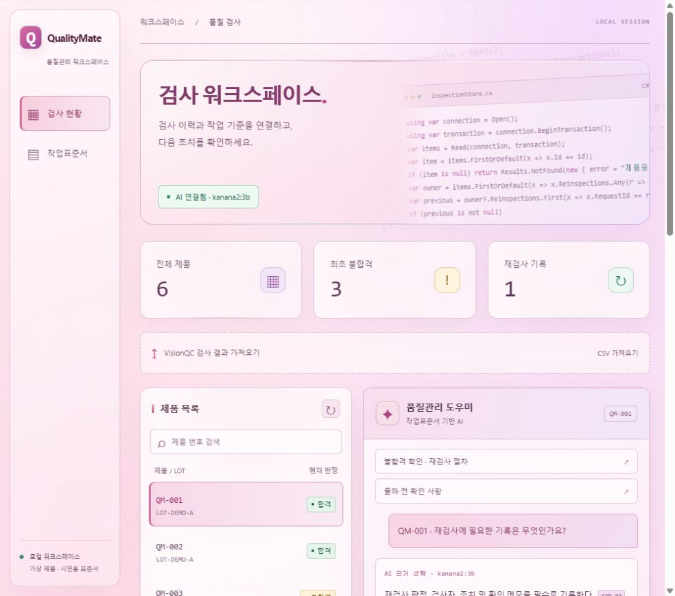
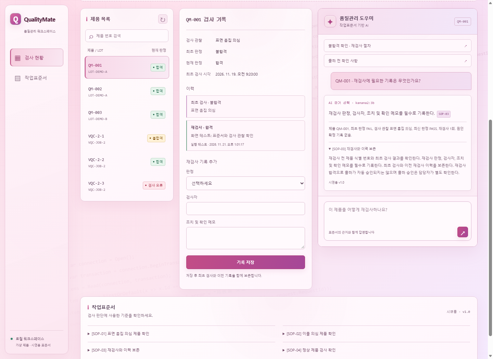
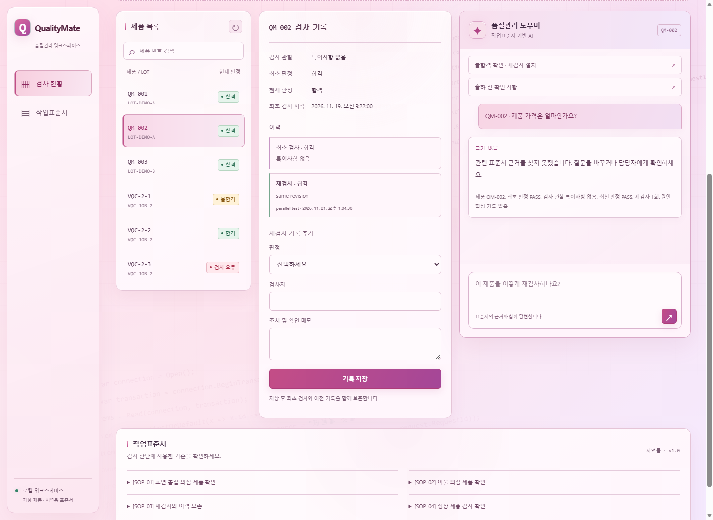
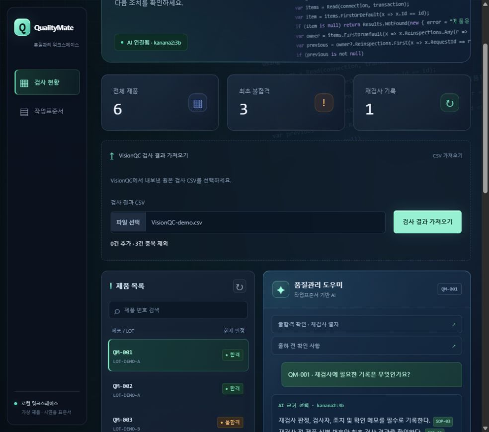
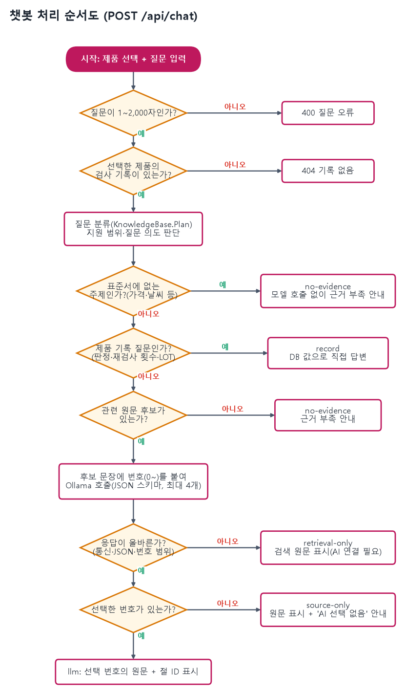
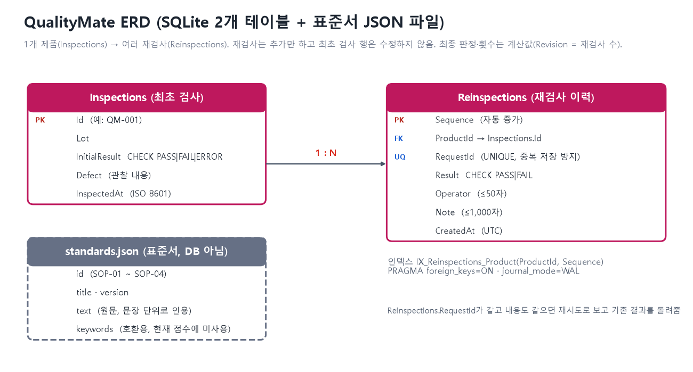

# 포트폴리오 — QualityMate

## 한 줄 소개
제품별 **검사 이력**과 **작업표준서 원문**을 한 화면에서 연결하고, 챗봇이 표준서 문장을 **번호로 선택해 원문 그대로** 보여 주며, 재검사는 **최초 기록을 보존한 채** 중복·동시 저장에도 안전하게 저장하는 품질관리 지원 시스템.

## 프로젝트 정보
| 항목 | 내용 |
|---|---|
| 작성자 | 반재영 (개인 프로젝트, 기획·설계·구현·테스트·문서 전 과정) |
| 기간 | 2026.11.19 ~ 12.30 (기획서 12/04, 발표 12/30) |
| 기술 | C# / .NET 10, ASP.NET Core 최소 API, SQLite(Microsoft.Data.Sqlite), Ollama(kanana2:3b), HTML/CSS/JavaScript |
| 코드 | `projects/QualityMate` (C# 약 600줄 + 화면 + 시험 도구, 모든 파일에 무엇을·왜 주석) |

## 문제와 해결
- **문제**: 검사 결과와 재검사 절차가 따로 있어 근거를 찾기 어렵고, 재검사로 판정을 덮어쓰면 최초 사유가 사라지며, 챗봇은 표준서에 없는 내용을 그럴듯하게 지어낸다. 재시도·동시 저장으로 기록이 꼬이기도 한다.
- **해결**: ① 제품 이력과 표준서를 한 화면에 연결 ② LLM은 **번호만 선택**, 서버가 검증해 **원문+절 ID**만 출력 ③ 표준서에 없는 질문은 **모델 호출 없이** 거절 ④ 재검사는 추가 전용 + 요청 ID(UNIQUE) + 버전 비교를 **한 트랜잭션**으로 ⑤ 머신비전 CSV는 전체 성공 또는 전체 취소.

## 핵심 성과
- **지어낼 수 없는 답변 구조**: 사용자에게 보이는 문장은 표준서 원문 또는 DB 값뿐. 모델이 `[0,0,0,0,0]`처럼 4개 제한을 어기는 출력(중복 제거 전 길이로 검사), 음수·문자열·범위 밖 번호를 내면 거부.
- **이력 보존**: 최초 FAIL → 재검사 PASS 후에도 최초 불합격이 남고, 현재 판정과 횟수는 재검사 목록에서 계산해 어긋날 수 없음.
- **재시도·동시 저장 안전**: 같은 요청 ID·같은 내용은 기존 결과 반환(중복 저장 없음), 같은 ID 다른 내용·오래된 버전은 409. 비교와 삽입이 같은 쓰기 트랜잭션.
- **정직한 구분**: AI가 선택하지 않은 경우 `source-only`, AI 오류는 `retrieval-only`로 표시해 AI 성공으로 세지 않음. 실제 모델 20문항 반복에서 `llm` 12 · `source-only` 8.
- 검증: 기능 검사 17/17, 고정 질문 20/20(2026-11-19), 실제 모델 회귀 56/56, 모의 모델 계약 11/11(2026-11-21), 환경 진단 3건. LLM 호출 질문 중앙값 2.98초.

## 화면
| 검사 현황과 챗봇(핑크 코드 테마) | AI 근거 선택 답변(SOP-03 인용) |
|---|---|
|  |  |

| 범위 밖 질문 거절(모델 호출 없음) | VisionQC CSV 가져오기 |
|---|---|
|  |  |

## 아키텍처·데이터

## 내가 한 기술적 선택과 이유
| 선택 | 이유 |
|---|---|
| LLM은 번호 선택만 | 자유 생성은 원문 반복·인용 누락·지어내기. 번호 + JSON 스키마 + 서버 검증으로 환각 차단 |
| 범위 밖은 모델 호출 전에 거절 | 스키마가 "최소 1개 선택"을 강제하면 모델이 관련 없는 문장을 억지로 고름(11/21 가격 질문 오답) |
| 현재 판정·횟수는 계산 | 저장하면 갱신 누락으로 어긋남. 재검사 목록에서 계산 |
| 요청 ID UNIQUE + 트랜잭션 | 네트워크 재시도·더블 클릭에도 한 번만 저장 |
| SQL Server → SQLite | 설치 없는 제출·시연 재현성. 트랜잭션·제약은 동일하게 확보 |
| 규칙 기반 분류(검색 방식 명시) | 4개 시연 SOP에 맞춘 설명 가능한 분류. BM25·임베딩이라고 설명하지 않음 |

## 측정으로 발견해 고친 것
1. 자유 생성 답변에서 원문 반복·인용 누락 → JSON 스키마 번호 선택으로 변경.
2. "제품 가격은 얼마인가요?"에 "흠집 제품은 출하를 보류한다"가 답으로 나옴 → 단어 하나 겹침 검색 + 최소 1개 선택 스키마가 원인. 범위 밖 질문을 모델 호출 전 거절하고 의도에 맞는 문장만 후보로.
3. `source-only` 통과를 AI 정확도로 해석할 위험 → 별도 모드로 구분 표시, 통계에서 분리.
4. 중복 제거 **후** 길이로 검사하면 `[0,0,0,0,0]`을 통과시킴 → 원시 길이로 검사.

## 배운 점과 한계
- "원문이 맞다"와 "질문에 답했다"는 다르다. 고정 질문 통과는 검색·인용·원문 일치를 본 것이며 일반적인 현장 정확도가 아니다.
- 표준서·검사 데이터는 직접 만든 **가상 데이터**, 분류는 4개 SOP에 맞춘 규칙 기반이라 새 표현·문서 확장에는 추가 평가가 필요하다.
- 3B 모델은 근거를 선택하지 않는 경우가 많다(8/20). 더 큰 모델과의 비교는 하지 못했다.
- 인증·권한이 없어 127.0.0.1 전용이며, 실제 카메라 추론·다른 PC 운영은 검증하지 않았다.
- 12월: 발표 PC 환경 점검, 질문 세트 확장, 현장 용어 검토.

## 산출물
기획서 · 요구사항 분석서 · 요구사항 명세서 · 데이터정의서(ERD) · 순서도 · 개발일정표 · 결과보고서 · 발표자료(PPTX·PDF) · 소스 코드 · 시험 도구
